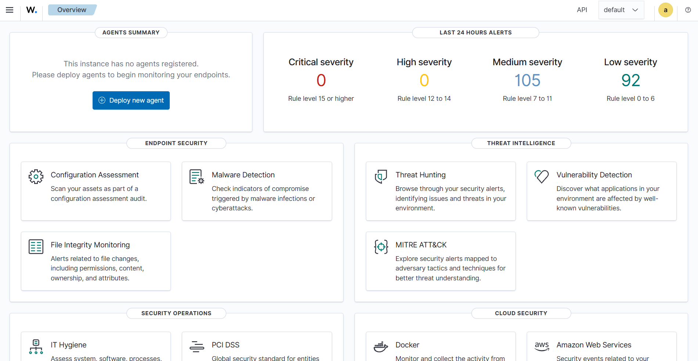

# XDR-Home-Lab: Endpoint-Sicherheit mit Wazuh und Sophos XDR

Ein Lernprojekt, in dem ich eine kleine Unternehmensumgebung unter Hyper-V aufbaue und mit zwei XDR-Lösungen absichere: dauerhaft mit **Wazuh** (Open Source) und für 30 Tage mit **Sophos XDR** (Testversion). Ziel ist, Sicherheitsvorfälle zu erkennen, zu analysieren und nachvollziehbar zu bearbeiten.

## Was dieses Projekt zeigt

- Aufbau einer XDR/SIEM-Plattform und Verteilung von Agenten auf Windows und Linux
- Erkennung typischer Angriffsmuster mit harmlosen, reproduzierbaren Testszenarien
- Eigene Erkennungsregeln, zugeordnet zu MITRE ATT&CK
- Automatisierung mit PowerShell (Agentenbericht über die Wazuh-API, Testszenarien)
- Bearbeitung von Vorfällen nach einem festen Ablauf (Playbook)
- Vergleich einer Open-Source-Lösung mit einer kommerziellen XDR-Plattform
- Ticketsystem Zammad: Alarme werden automatisch zu Tickets für die Bearbeitung im IT-Support

## Aufbau

| VM | System | Ressourcen | Rolle |
| --- | --- | --- | --- |
| `wazuh01` | Red Hat Enterprise Linux 10 | 4 vCPU, 8 GB RAM | Wazuh-Server, Indexer, Dashboard (Wazuh 4.14) |
| `client01` | Windows 11 | 2 vCPU, 4–8 GB RAM, 64 GB | Arbeitsplatz mit Wazuh-Agent, Sysmon, später Sophos-Agent |
| `zammad01` | Ubuntu Server 24.04 | 2 vCPU, 6 GB RAM, 40 GB | Ticketsystem Zammad |
| `srv01` (optional) | Windows Server 2022 | 2 vCPU, 4 GB RAM, 60 GB | Domänencontroller für realistische Anmeldeereignisse |

Aktuell hängen die VMs am Hyper-V-Standardswitch (*Default Switch*); ein eigener interner Switch mit NAT ist geplant. Details: [docs/01-architektur.md](docs/01-architektur.md)

## Stand

Wazuh 4.14 läuft auf `wazuh01`, das Dashboard ist erreichbar. Als Nächstes folgt der Windows-Client mit Agent und Sysmon.

## Inhalt

| Ordner | Inhalt |
| --- | --- |
| [docs/](docs/) | Schritt-für-Schritt-Dokumentation |
| [config/](config/) | Konfigurationsausschnitte für Wazuh-Agent und Sysmon |
| [rules/](rules/) | Eigene Wazuh-Erkennungsregeln |
| [scripts/](scripts/) | PowerShell-Skripte für Bericht und Testszenarien |
| [playbooks/](playbooks/) | Ablauf zur Bearbeitung von Sicherheitsvorfällen |
| [integrations/](integrations/) | Anbindung Wazuh → Zammad |

## Fortschritt

- [ ] 1. Hyper-V-Netz und VMs anlegen – `wazuh01` läuft, `client01` folgt ([docs/01-architektur.md](docs/01-architektur.md))
- [x] 2. Wazuh installieren ([docs/02-wazuh-installation.md](docs/02-wazuh-installation.md))
- [ ] 3. Agenten und Sysmon einrichten ([docs/03-agenten.md](docs/03-agenten.md))
- [ ] 4. Testszenarien durchführen und dokumentieren ([docs/04-testszenarien.md](docs/04-testszenarien.md))
- [ ] 5. Eigene Regeln testen ([rules/local_rules.xml](rules/local_rules.xml))
- [ ] 6. Sophos XDR 30 Tage testen ([docs/05-sophos-xdr.md](docs/05-sophos-xdr.md))
- [ ] 7. Vergleich und Fazit ([docs/06-vergleich.md](docs/06-vergleich.md))
- [ ] 8. Ticketsystem Zammad aufbauen und an Wazuh anbinden ([docs/07-ticketsystem.md](docs/07-ticketsystem.md))

## Sicherheitshinweis

Alle Testszenarien sind harmlos (zum Beispiel die EICAR-Testdatei) und laufen ausschließlich in einer isolierten Laborumgebung. Es wird keine echte Schadsoftware verwendet. Zugangsdaten, IP-Adressen außerhalb des Labors und Screenshots mit persönlichen Daten gehören nicht in dieses Repository.

## Lizenz

MIT, siehe [LICENSE](LICENSE).
