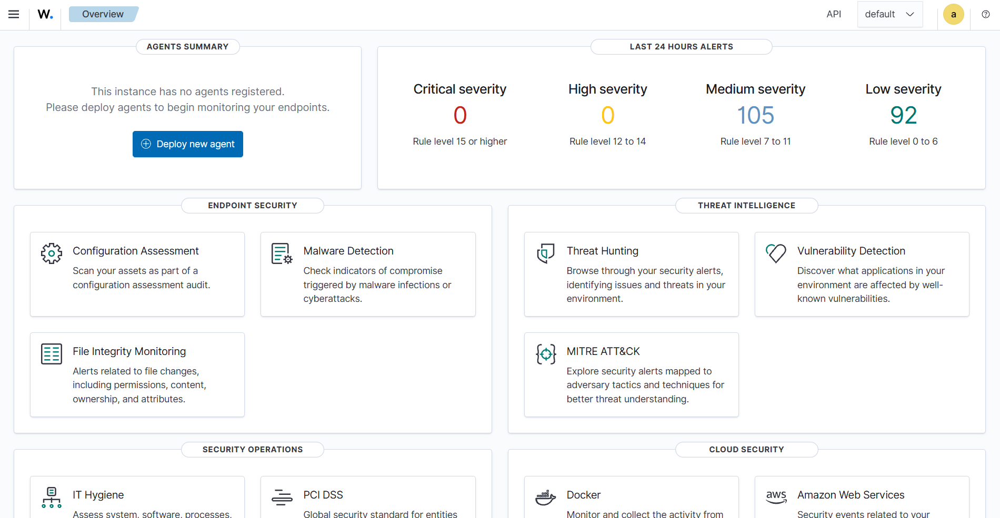

# 2. Wazuh-Server installieren

Wazuh besteht aus drei zentralen Komponenten: Indexer (Datenhaltung), Server (Analyse und Regeln) und Dashboard (Weboberfläche). Für ein Labor laufen alle drei auf einer VM.

Quelle: [Wazuh Quickstart](https://documentation.wazuh.com/current/quickstart.html)

## Voraussetzungen

- RHEL 9 oder 10 (64 Bit), Hostname `wazuh01` – im Labor eingesetzt: **RHEL 10**
- System bei Red Hat registriert, damit die Paketquellen BaseOS und AppStream verfügbar sind
- 4 vCPU, 8 GB RAM, mindestens 50 GB Speicher (Herstellerempfehlung für bis zu 25 Agenten)

## Installation

Auf `wazuh01`:

```bash
curl -sO https://packages.wazuh.com/4.14/wazuh-install.sh && sudo bash ./wazuh-install.sh -a
```

Am Ende zeigt der Installer Benutzer (`admin`) und Passwort für das Dashboard. Das Passwort sicher notieren, **nicht** in dieses Repository schreiben.

Passwörter später erneut anzeigen:

```bash
sudo tar -O -xvf wazuh-install-files.tar wazuh-install-files/wazuh-passwords.txt
```

## Firewall öffnen

```bash
sudo firewall-cmd --permanent --add-port={443,1514,1515,55000}/tcp
sudo firewall-cmd --reload
```

## Prüfen

- Dashboard im Browser des Hosts öffnen: `https://<IP von wazuh01>` (Zertifikatswarnung im Labor bestätigen)
- Dienste prüfen:

```bash
sudo systemctl status wazuh-manager wazuh-indexer wazuh-dashboard
```

## Notizen

**20.11.2026 – Installation auf RHEL 10**

Vorbereitung:

```bash
sudo hostnamectl set-hostname wazuh01
free -h                               # 7,5 GiB RAM verfügbar
```

**Problem 1 – Namensauflösung:** `ping packages.wazuh.com` meldete „Name oder Dienst nicht bekannt“, `ping 8.8.8.8` funktionierte. Die Verbindung ins Internet stand also, nur DNS fehlte. `/etc/resolv.conf` zeigte als einzigen Nameserver das Gateway des Hyper-V-Default-Switch (172.17.64.1), das Anfragen nicht zuverlässig beantwortete.

Lösung – DNS-Server fest für die Verbindung `eth0` setzen:

```bash
sudo nmcli connection modify eth0 ipv4.dns "1.1.1.1 8.8.8.8" ipv4.ignore-auto-dns yes
sudo nmcli connection up eth0
cat /etc/resolv.conf                  # nameserver 1.1.1.1 / 8.8.8.8
```

**Problem 2 – System nicht registriert:** `sudo subscription-manager status` meldete „Not registered“. Ohne Registrierung stehen die Red-Hat-Paketquellen nicht zur Verfügung, die der Installer für Abhängigkeiten braucht.

Lösung – mit dem kostenlosen Red-Hat-Developer-Abo registrieren:

```bash
sudo subscription-manager register --username <Red-Hat-Benutzer>
sudo dnf repolist                     # baseos-rpms und appstream-rpms vorhanden
```

**Installation und Firewall:** Danach liefen Installer und Firewall-Freigabe wie oben beschrieben ohne Fehler.

Hinweis: Mehrere Befehle auf einmal in die SSH-Sitzung einzufügen, führte dazu, dass Zeilen zusammengezogen wurden (z. B. `--reload` wurde nicht ausgeführt). Befehle deshalb einzeln einfügen und die Ausgabe prüfen, etwa mit `sudo firewall-cmd --list-ports`.

**Ergebnis:** Dashboard unter `https://172.17.71.77` erreichbar, Anmeldung als `admin` erfolgreich. Ohne angebundene Agenten zeigte das Dashboard bereits erste Ereignisse des Servers selbst.


