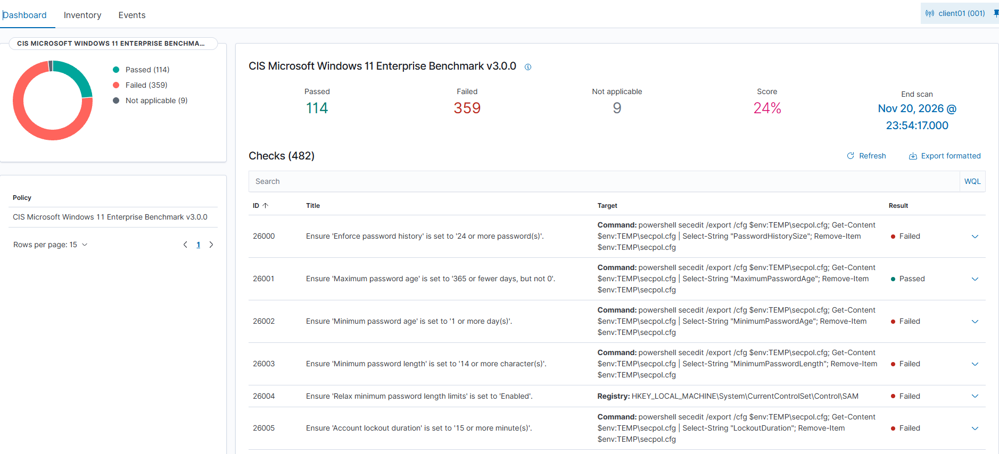
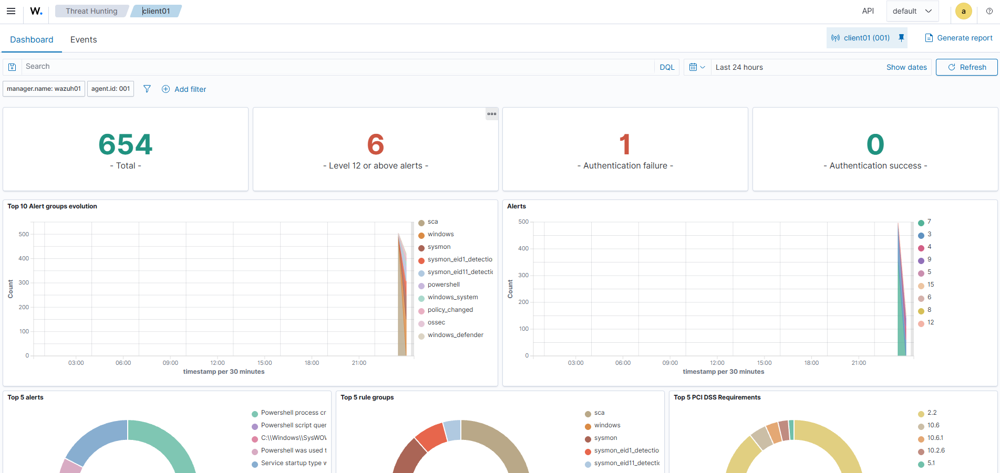

# 3. Agenten und Sysmon einrichten

## Wazuh-Agent auf Windows 11

Den passenden Installationsbefehl erzeugt das Dashboard selbst: **Agents management → Summary → Deploy new agent**. Dort Windows wählen, als Serveradresse die IP von `wazuh01` eintragen (im Labor aktuell `172.17.71.77`) und den angezeigten PowerShell-Befehl auf `client01` als Administrator ausführen. So stimmt die Agentenversion immer mit dem Server überein.

Danach den Dienst starten:

```powershell
NET START Wazuh
```

## Sysmon installieren

Sysmon (Microsoft Sysinternals) protokolliert Prozessstarts, Netzwerkverbindungen und weitere Ereignisse deutlich genauer als das Standard-Ereignisprotokoll. Ohne Sysmon sieht Wazuh zum Beispiel keine vollständigen Befehlszeilen.

1. Sysmon von [Microsoft Learn](https://learn.microsoft.com/sysinternals/downloads/sysmon) herunterladen.
2. Eine bewährte Konfiguration verwenden, zum Beispiel [SwiftOnSecurity/sysmon-config](https://github.com/SwiftOnSecurity/sysmon-config).
3. Installieren:

```powershell
.\Sysmon64.exe -accepteula -i sysmonconfig-export.xml
```

## Agent anweisen, die Ereignisse zu lesen

Den Ausschnitt aus [config/agent-windows-ossec.conf](../config/agent-windows-ossec.conf) in `C:\Program Files (x86)\ossec-agent\ossec.conf` innerhalb von `<ossec_config>` einfügen und den Agenten neu starten:

```powershell
Restart-Service -Name Wazuh
```

Damit liest der Agent zusätzlich:

- Sysmon (Prozessstarts, Netzwerk)
- PowerShell-Protokoll (Skriptblöcke)
- Microsoft Defender (Erkennungen)

## PowerShell-Skriptblockprotokollierung aktivieren

Über Gruppenrichtlinie oder lokal auf `client01`:

```powershell
$key = "HKLM:\SOFTWARE\Policies\Microsoft\Windows\PowerShell\ScriptBlockLogging"
New-Item -Path $key -Force | Out-Null
Set-ItemProperty -Path $key -Name EnableScriptBlockLogging -Value 1
```

## Prüfen

- Im Dashboard muss `client01` als **active** erscheinen.
- Bericht per Skript: [scripts/Get-WazuhAgentStatus.ps1](../scripts/Get-WazuhAgentStatus.ps1)

## Notizen

20.11.2026: Alte Windows-VMs unbrauchbar, Windows 11 Multi-Edition (Evaluierungsversion) als ISO für client01 heruntergeladen.

**20.11.2026 – client01 eingerichtet und Agent verbunden**

- Windows 11 (Edition Pro Education, Build 26300) als Generation-2-VM mit virtuellem TPM installiert, Computername `client01`, Netz: Hyper-V *Default Switch*.
- Stolperstein beim Anlegen der VM: `Add-VMDvdDrive` wurde versehentlich mehrfach ausgeführt. Danach scheiterte `Set-VMFirmware -FirstBootDevice`, weil `Get-VMDvdDrive` mehrere Laufwerke zurückgab. Lösung:

```powershell
Get-VMDvdDrive -VMName client01 | Select-Object -Skip 1 | Remove-VMDvdDrive
Set-VMFirmware -VMName client01 -FirstBootDevice (Get-VMDvdDrive -VMName client01 | Select-Object -First 1)
```

- Wazuh-Agent 4.14.10 installiert. Der erste Download mit `Invoke-WebRequest` brach mit einem Timeout ab. DNS war nicht die Ursache (`Resolve-DnsName` antwortete sofort), sondern die Fortschrittsanzeige von Windows PowerShell 5.1, die große Downloads stark verlangsamt. Lösung:

```powershell
$ProgressPreference = 'SilentlyContinue'
Invoke-WebRequest -Uri https://packages.wazuh.com/4.x/windows/wazuh-agent-4.14.10-1.msi -OutFile $env:tmp\wazuh-agent
msiexec.exe /i $env:tmp\wazuh-agent /q WAZUH_MANAGER='172.17.71.77' WAZUH_AGENT_NAME='client01'
NET START Wazuh
```

- Ergebnis: `client01` ist als Agent 001 verbunden. Die Konfigurationsprüfung (SCA) nach **CIS Microsoft Windows 11 Enterprise Benchmark v3.0.0** lief sofort durch: 114 von 482 Prüfungen bestanden, 359 nicht bestanden, 9 nicht anwendbar – **Score 24 %**. Für eine frisch installierte, nicht gehärtete Windows-Installation ist das zu erwarten.



Idee für später: einen Teil der Empfehlungen (z. B. Kennwortrichtlinien, Kontosperrung) per Gruppenrichtlinie umsetzen und die Veränderung des Scores dokumentieren.

**21.11.2026 – Sysmon und zusätzliche Ereignisprotokolle**

- Sysmon mit der Konfiguration von SwiftOnSecurity installiert, PowerShell-Skriptblockprotokollierung aktiviert und die drei Kanäle (Sysmon, PowerShell, Defender) in die `ossec.conf` des Agenten eingetragen.
- Stolperstein: Der Konfigurationsblock wurde versehentlich zweimal angehängt. Der Agent meldete daraufhin `WARNING: (1958): Log file '…' is duplicated`. Lösung: einen der beiden Blöcke in `ossec.conf` löschen und den Dienst neu starten.
- Kontrolle im Agentenprotokoll: `INFO: (1951): Analyzing event log: 'Microsoft-Windows-Sysmon/Operational'` (ebenso für PowerShell und Defender). Kurz darauf zeigte das Dashboard bereits Ereignisse der Gruppen `sysmon`, `powershell` und `windows_defender`.


