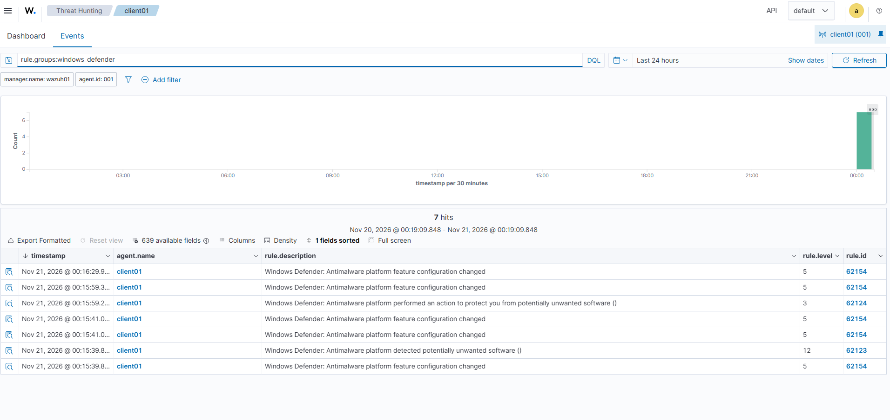
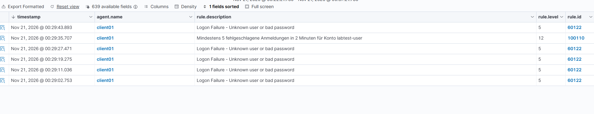

# 4. Testszenarien

Alle Szenarien werden mit [scripts/Invoke-LabTestScenario.ps1](../scripts/Invoke-LabTestScenario.ps1) auf `client01` ausgelöst und sind harmlos.

```powershell
.\Invoke-LabTestScenario.ps1 -Scenario All -ConfirmLab
```

## Übersicht

| Nr. | Szenario | MITRE ATT&CK | Erwartete Erkennung | Wazuh | Sophos XDR |
| --- | --- | --- | --- | --- | --- |
| T1 | EICAR-Testdatei | – | Virenschutz-Fund | erkannt (Regel 62123, Stufe 12) | offen |
| T2 | 6 fehlgeschlagene Anmeldungen | T1110 Brute Force | Regel 60122, eigene Regel 100110 | erkannt (60122 ×5, eigene Regel 100110, Stufe 12) | offen |
| T3 | Kodierter PowerShell-Befehl | T1059.001, T1027 | Sysmon-Ereignis 1, eigene Regel 100100 | offen | offen |

„offen“ nach dem Test ersetzen durch: erkannt (Regel/Alarm), teilweise oder nicht erkannt.

## Vorlage je Test

### T1 – EICAR-Testdatei

- **Datum/Uhrzeit:** 21.11.2026, 00:15 Uhr
- **Ausgelöst auf:** client01 (`Invoke-LabTestScenario.ps1 -Scenario Eicar -ConfirmLab`)
- **Erkannt durch:** Microsoft Defender auf client01; das Ereignis wurde über den Wazuh-Agenten (Kanal `Microsoft-Windows-Windows Defender/Operational`) an den Server gemeldet.
- **Alarm/Regel-ID und Stufe:**
  - 00:15:39 – Regel **62123**, Stufe **12**: „Windows Defender: Antimalware platform detected potentially unwanted software“
  - 00:15:59 – Regel **62124**, Stufe 3: „… performed an action to protect you from potentially unwanted software“ (Datei entfernt)
  - Daneben mehrere Ereignisse der Regel 62154 (Stufe 5, „feature configuration changed“)
- **Zeit bis zur Meldung:** wenige Sekunden; Erkennung und Gegenmaßnahme lagen 20 Sekunden auseinander.
- **Screenshot:** 
- **Erkenntnis:** Wazuh übernimmt die Defender-Meldungen zuverlässig und stuft den Fund mit Stufe 12 als kritisch ein. In der Kurzbeschreibung bleibt der Name der Bedrohung leer („()“); er steht nur in den Detailfeldern des Ereignisses. Für eine schnelle Bewertung im Alltag wäre eine eigene Regel mit dem Bedrohungsnamen in der Beschreibung hilfreich. Die Häufung von „feature configuration changed“ zeigt außerdem, dass Defender-Ereignisse ohne Filter schnell Rauschen erzeugen.

### T2 – Fehlgeschlagene Anmeldungen

- **Datum/Uhrzeit:** 21.11.2026, 00:29 Uhr
- **Ausgelöst auf:** client01 (`Invoke-LabTestScenario.ps1 -Scenario FailedLogon -ConfirmLab`): sechs Anmeldeversuche mit falschem Passwort für das Konto `labtest-user`, jeweils im Abstand von etwa acht Sekunden
- **Erkannt durch:** Windows-Sicherheitsprotokoll (Ereignis 4625) über den Wazuh-Agenten; Auswertung auf dem Server
- **Alarm/Regel-ID und Stufe:**
  - 00:29:02 bis 00:29:43 – Regel **60122**, Stufe 5: „Logon Failure – Unknown user or bad password“
  - 00:29:35 – eigene Regel **100110**, Stufe **12**: „Mindestens 5 fehlgeschlagene Anmeldungen in 2 Minuten für Konto labtest-user“ (MITRE ATT&CK T1110)
- **Screenshot:** 
- **Erkenntnis:** Die eigene Korrelationsregel funktioniert: Beim fünften Fehlversuch innerhalb von zwei Minuten meldet Wazuh statt eines einzelnen Fehlversuchs (Stufe 5) einen Brute-Force-Verdacht (Stufe 12). Dieses fünfte Ereignis erscheint deshalb nicht mehr als 60122, sondern als 100110 – die Liste zeigt fünfmal 60122 und einmal 100110. Die Einzelereignisse allein wären im Alltag leicht zu übersehen; erst die Korrelation macht daraus einen klaren Alarm.

### T3 – Kodierter PowerShell-Befehl

- **Datum/Uhrzeit:**
- **Erkannt durch:**
- **Alarm/Regel-ID und Stufe:**
- **Erkenntnis:**
