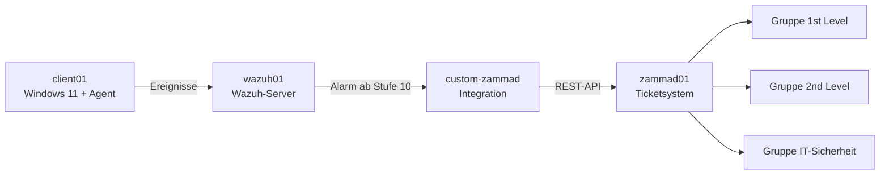

# 7. Ticketsystem Zammad und Anbindung an Wazuh

## Ziel

Sicherheitsvorfälle sollen nicht nur im Wazuh-Dashboard auftauchen, sondern als Ticket nachvollziehbar bearbeitet werden – so, wie es im IT-Support üblich ist. Dafür kommt das Open-Source-Ticketsystem **Zammad** ins Labor. Wazuh legt ab einer festgelegten Alarmstufe automatisch ein Ticket an.



## VM

| VM | System | Ressourcen | Rolle |
| --- | --- | --- | --- |
| `zammad01` | Ubuntu Server 24.04 | 2 vCPU, 6 GB RAM, 40 GB | Zammad (Docker Compose) |

Zammad bringt eine eigene Suche (Elasticsearch) mit und braucht deshalb etwas mehr Arbeitsspeicher.

## Installation (auf `zammad01`)

Docker installieren:

```bash
sudo apt update && sudo apt install -y docker.io docker-compose-v2 git
sudo usermod -aG docker $USER      # danach ab- und wieder anmelden
```

Zammad mit dem offiziellen Docker-Compose-Projekt starten:

```bash
git clone https://github.com/zammad/zammad-docker-compose.git
cd zammad-docker-compose
docker compose up -d
docker compose ps                  # alle Dienste "running" / "healthy"
```

Weboberfläche: `http://<IP von zammad01>:8080` – beim ersten Aufruf führt ein Assistent durch Organisation, Admin-Konto und E-Mail (E-Mail im Labor überspringen).

Quelle: [Zammad-Dokumentation, Installation mit Docker Compose](https://docs.zammad.org/en/latest/install/docker-compose.html)

## Einrichtung („Pflege“)

| Bereich | Einstellung im Labor |
| --- | --- |
| Gruppen | `1st Level`, `2nd Level`, `IT-Sicherheit` |
| Rollen | Agent für die eigenen Gruppen; Admin nur für das eigene Konto |
| Prioritäten | `1 low`, `2 normal`, `3 high` (Standard) |
| SLA „IT-Sicherheit“ | Erste Reaktion 1 Stunde, Lösung 8 Stunden (Arbeitszeit) |
| Textbausteine | „Passwort zurückgesetzt“, „Rückfrage zum Gerät“, „Sicherheitsvorfall geprüft – kein Handlungsbedarf“ |
| Wissensdatenbank | 3–4 kurze Anleitungen, z. B. „MFA einrichten“, „Freigegebenes Postfach einbinden“ |

## Optimierung

- **Trigger:** Tickets mit dem Tag `wazuh` landen automatisch in der Gruppe `IT-Sicherheit`; Priorität `3 high` erzeugt eine Benachrichtigung.
- **Eskalation:** Wird die SLA-Reaktionszeit überschritten, erscheint das Ticket in der Übersicht „Eskaliert“.
- **Übersichten:** eigene Ansicht „Offene Sicherheitsvorfälle“.
- **Auswertung:** Anzahl Tickets je Gruppe und Bearbeitungszeit im Reporting-Bereich.

## Anbindung an Wazuh

1. In Zammad ein **Zugriffstoken** anlegen: Profil → Token-Zugriff → Berechtigung `ticket.agent`. Das Token **nicht** in dieses Repository schreiben.
2. Das Skript [integrations/custom-zammad](../integrations/custom-zammad) auf `wazuh01` ablegen:

```bash
sudo cp custom-zammad /var/ossec/integrations/custom-zammad
sudo chown root:wazuh /var/ossec/integrations/custom-zammad
sudo chmod 750 /var/ossec/integrations/custom-zammad
```

3. In `/var/ossec/etc/ossec.conf` innerhalb von `<ossec_config>` ergänzen:

```xml
<integration>
  <name>custom-zammad</name>
  <hook_url>http://<IP von zammad01>:8080/api/v1/tickets</hook_url>
  <api_key>ZAMMAD-TOKEN</api_key>
  <level>10</level>
  <alert_format>json</alert_format>
</integration>
```

4. Wazuh neu starten und Protokoll beobachten:

```bash
sudo systemctl restart wazuh-manager
sudo tail -f /var/ossec/logs/integrations.log
```

Das Skript übernimmt Agent, Regel, Stufe und MITRE-ATT&CK-Technik in das Ticket und ordnet die Wazuh-Stufe einer Zammad-Priorität zu (ab 12 → hoch, ab 7 → normal).

## Test

Testszenario T2 (fehlgeschlagene Anmeldungen) aus [04-testszenarien.md](04-testszenarien.md) erneut auslösen. Erwartung: Alarm im Dashboard **und** neues Ticket in der Gruppe `IT-Sicherheit`.

| Szenario | Alarm in Wazuh | Ticket in Zammad | Zeit bis Ticket |
| --- | --- | --- | --- |
| T2 | offen | offen | |
| T3 | offen | offen | |

## Notizen

_Hier eigene Beobachtungen, Probleme und Lösungen festhalten._
